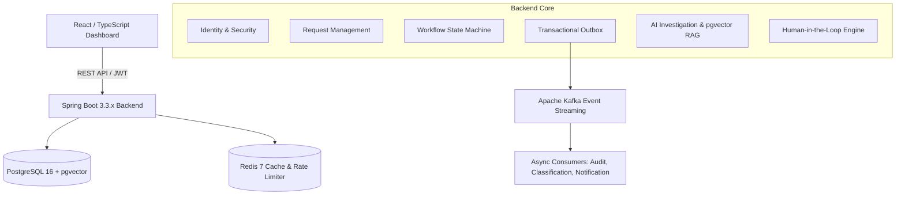
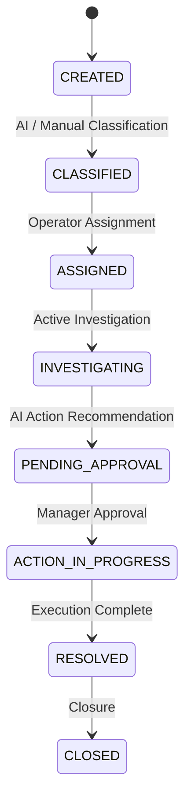

# OpsFlow AI — AI-Powered Distributed Business Operations & Workflow Platform

> **OpsFlow AI** is an event-driven business operations and workflow platform. It manages operational requests, enforces workflow state machine business rules, investigates incidents using system telemetry and RAG knowledge embeddings, and provides evidence-backed recommendations under deterministic backend authorization.

---

## 🌟 Core Architecture & Key Capabilities

- **Backend-Driven Control Plane:** AI provides evidence-backed recommendations, while Java backend services authorize and execute state transitions and business rules.
- **Workflow State Machine:** Enforces validated operational status transitions (`CREATED` → `CLASSIFIED` → `ASSIGNED` → `INVESTIGATING` → `PENDING_APPROVAL` → `RESOLVED` → `CLOSED`), preventing invalid state mutations.
- **Transactional Outbox Pattern:** Ensures atomic consistency between PostgreSQL entity updates and Apache Kafka event publishing.
- **Idempotent Consumer Processing:** Prevents duplicate message processing using `ProcessedEvent` tracking across Kafka consumer groups.
- **Controlled AI Tool Proxies:** Eliminates direct SQL/database access for LLMs. All reasoning tools run via authenticated Java proxies (`AIToolRegistry`).
- **pgvector RAG Embeddings:** Semantic vector search over operational runbooks directly within PostgreSQL using pgvector HNSW indexing.
- **Human-in-the-Loop Approvals:** Sensitive actions require explicit RBAC Manager authorization before execution.
- **Distributed Observability:** OpenTelemetry correlation tracking (`X-Correlation-ID`), Micrometer/Prometheus endpoints, structured MDC logging, and a React TypeScript dashboard.

---

## 📐 System Topology & State Machine

### System Topology



### Request Lifecycle State Machine



---

## 🛠️ Technology Stack

- **Backend:** Java 17+ / Spring Boot 3.3.x, Spring Data JPA, Spring Security 6, Jackson, Lombok
- **Database:** PostgreSQL 16 with pgvector extension, H2 (for zero-dependency local development)
- **Event Streaming:** Apache Kafka, Transactional Outbox Pattern, Consumer Idempotency, DLQ
- **Caching & Rate Limiting:** Redis 7 (Token Bucket Rate Limiting & Cache-aside)
- **AI & RAG:** Spring AI Abstraction, pgvector embeddings, Controlled Tool Proxies (`AIToolRegistry`)
- **Frontend:** React 18, TypeScript, Vite, Lucide Icons, Modern Dark Mode Glassmorphism Theme
- **Observability & Infrastructure:** OpenTelemetry MDC tracing, Prometheus, Grafana, Docker Compose, JUnit 5, k6

---

## 📁 Repository Structure

```
opsflow-ai/
├── .github/
│   └── workflows/ci.yml                             # GitHub Actions CI pipeline
├── backend/
│   ├── pom.xml                                      # Spring Boot 3.3.x Maven configuration
│   ├── mvnw.cmd                                     # Portable Maven Wrapper for Windows
│   └── src/
│       ├── main/java/com/opsflow/
│       │   ├── identity/                            # Security, JWT, Users, Roles, Permissions
│       │   ├── request/                             # Request entity with Optimistic Locking (@Version)
│       │   ├── workflow/                            # WorkflowStateMachine transition matrix
│       │   ├── outbox/                              # Transactional Outbox pattern & OutboxPublisher
│       │   ├── events/                              # DomainEvent envelope & ProcessedEvent idempotency
│       │   ├── audit/                               # AuditEvent persistence & correlation tracking
│       │   ├── knowledge/                           # KnowledgeDocument, KnowledgeChunk, VectorStoreService
│       │   ├── ai/                                  # AIToolRegistry, AIProvider, AIInvestigationService
│       │   ├── approval/                            # Human-in-the-Loop ApprovalService
│       │   └── analytics/                           # Real-time metrics controller
│       └── test/java/                               # JUnit 5 unit tests
├── frontend/
│   ├── package.json / vite.config.ts                # React 18 & Vite build config
│   └── src/                                         # React dashboard views & components
├── infrastructure/
│   ├── docker-compose.yml                           # Postgres (pgvector), Redis, Kafka, Prometheus, Grafana
│   └── prometheus/                                  # Prometheus metrics scraper configuration
├── load-tests/                                      # k6 performance load test script
├── scripts/                                         # Automated demo.sh and verify.sh scripts
├── docs/                                            # Public Technical Documentation Directory
│   ├── api/                                         # API Contract specifications
│   ├── architecture/                                # Technical topology & state machine matrix
│   ├── events/                                      # Kafka event topic schemas & Outbox tables
│   └── operations/                                  # Resiliency matrix & failure scenarios
└── interview-prep/                                  # Personal Preparation & System Ownership Guide
```

---

## 🚀 Quick Start Guide

### 1. Run Backend (Spring Boot)
From `backend/` directory:
```powershell
.\mvnw.cmd spring-boot:run
```
> Starts API server on **`http://localhost:8080`**. Pre-seeds H2 database with default users, runbooks, and sample operational requests.

### 2. Run Frontend Dashboard
From `frontend/` directory:
```powershell
npm run dev
```
> Starts React Dashboard on **`http://localhost:3000`**.

### Default Credentials
- **Admin:** `admin` / `admin123`
- **Manager:** `manager` / `manager123`
- **Agent:** `agent` / `agent123`
- **Operator:** `operator` / `operator123`
- **Viewer:** `viewer` / `viewer123`

---

## 📖 Public Technical Documentation

Detailed technical specifications are available in the [`docs/`](file:///c:/Users/Iamsrkg/OneDrive/Desktop/Opsflow%20AI/docs) directory:
- [System Architecture](file:///c:/Users/Iamsrkg/OneDrive/Desktop/Opsflow%20AI/docs/architecture/ARCHITECTURE.md)
- [API Contract Specification](file:///c:/Users/Iamsrkg/OneDrive/Desktop/Opsflow%20AI/docs/api/API_CONTRACT.md)
- [Event & Outbox Specification](file:///c:/Users/Iamsrkg/OneDrive/Desktop/Opsflow%20AI/docs/events/EVENT_CONTRACT.md)
- [Failure Scenarios & Resiliency](file:///c:/Users/Iamsrkg/OneDrive/Desktop/Opsflow%20AI/docs/operations/FAILURE_SCENARIOS.md)

---

## 📜 License
MIT License.
