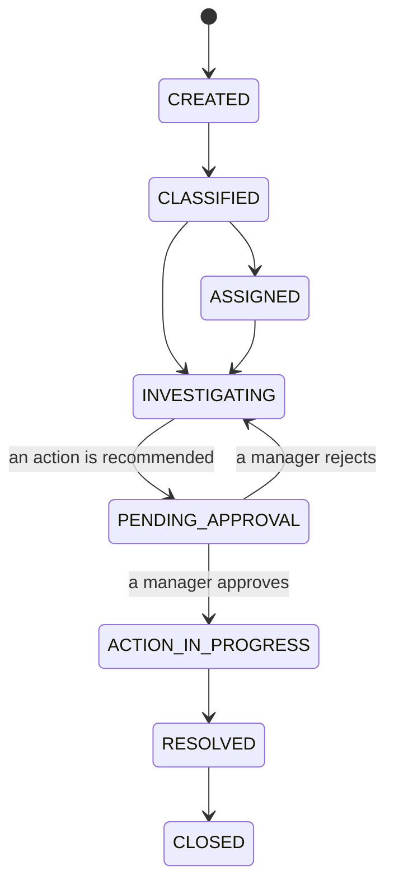
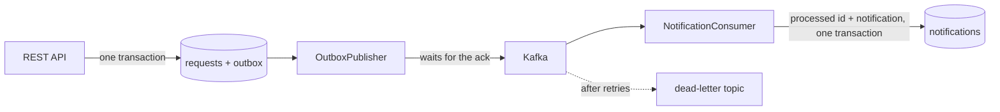
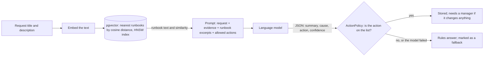

# OpsFlow AI — AI-assisted business operations and workflow platform

[](https://github.com/iamsrkg/opsflow-ai/actions/workflows/ci.yml)

> **OpsFlow AI** is an event-driven platform for business operations. It manages operational requests, enforces their workflow with a state machine, publishes every change reliably to Kafka, investigates each request using the system's own records and a searchable runbook library, and produces evidence-backed recommendations that only take effect once a manager approves them.

## Live demo

**With the real backend, in your browser:** [](https://codespaces.new/iamsrkg/opsflow-ai?quickstart=1)

One click starts the whole system (dashboard, Spring Boot backend, PostgreSQL with pgvector, Kafka and Redis) in your own GitHub account and opens the dashboard when it is ready. It is free, needs a GitHub login, and the first start takes a few minutes while the images build. Sign in with `manager` / `manager123`, `agent` / `agent123` or `viewer` / `viewer123`.

**On your machine:** `docker compose up --build`, then http://localhost:3000.

**Dashboard preview, no login:** https://iamsrkg.github.io/opsflow-ai/ shows the dashboard on its own with sample data. No backend is connected to that page, and a banner on it says so.

There is no permanently hosted copy of the backend; the Codespaces button and Docker Compose are the two ways to use the real thing.

**In one sentence:** OpsFlow AI is the system an operations team would use to handle customer problems, where every problem follows fixed steps, software suggests the fix, and a person approves it.

**In a little more detail.** A customer reports "I was charged but my order still says pending". Someone has to find out what happened and decide what to do, and the fix (replaying a payment, refunding, re-dispatching a parcel) is not something to get wrong. OpsFlow gives that work a shape:

1. The problem becomes a **request** with a status, and it can only move through allowed steps.
2. An **investigation** collects the facts and recommends an action. This is the "AI" in the name: it can read, and it can suggest, and nothing more.
3. A **manager approves or rejects** the action. Until then nothing happens.
4. Every step is **recorded**, and every change is **published as an event** that other systems can react to, without ever being lost or handled twice.

It is a backend project. The interesting parts are the guarantees behind those four lines: the workflow can't be bypassed, two people can't overwrite each other, an event survives Kafka being down, a redelivered event is handled once, and the AI step can't act on its own.

**Built with** Java 17 and Spring Boot 3.3, PostgreSQL with pgvector, Kafka, Redis, and a React dashboard. 50 tests run against the real services, CI starts the whole stack and tests it end to end, the same stack runs on [Kubernetes](#kubernetes) with pod-failure checks, and a [load test](#load-test) measures it: about 590 requests a second at a p95 of 188 ms on a 4-CPU machine, with all 23,622 events delivered and handled once.

## Why I built it

I'm a backend engineer, and most of what I have built at work is private. I built OpsFlow AI in the open, in October 2026, to put the patterns I use into one system that anyone can read, run and try to break: a workflow that can't be bypassed, events that are never lost or handled twice, and an AI step that is useful without being trusted.

It is a demonstration project, not a product with users. I chose operations support as the subject because it needs all of those guarantees at once: a wrong step, a lost event or an unapproved refund each has a real cost. Everything the README claims is covered by a test, and the limits are listed under [What it is not](#what-it-is-not).

## Tech stack

| Layer | What is used | What for |
|---|---|---|
| Language and framework | Java 17, Spring Boot 3.3 (Web, Data JPA, Security, Validation, Actuator) | The REST API and the application itself |
| Database | PostgreSQL 16, Hibernate, Flyway | Requests, audit trail, outbox and processed-event tables; versioned schema migrations |
| Vector search | pgvector with an HNSW index | Finding the closest runbook for an investigation |
| Messaging | Apache Kafka 3.8 (KRaft), Spring Kafka | Publishing every change as an event; a consumer with retries and dead-letter topics |
| Cache store | Redis 7 with a Lua script | Rate limiting only |
| Security | Spring Security, JWT (jjwt), BCrypt, five roles | Sign-in and what each role may do |
| AI | Retrieval-augmented generation: an embedding model for search and a language model for the recommendation, both run locally in Ollama (or any OpenAI-compatible API); keyword rules and feature hashing as the no-model default and fallback | Finding the right runbook and recommending an action |
| Dashboard | React 18, TypeScript, Vite, served by Nginx | Requests, investigations, approvals and the event counts |
| Tests | JUnit 5, MockMvc, Mockito, Testcontainers, embedded Kafka, k6, an evaluation set | 50 automated tests, the load test and the AI evaluation |
| Packaging and running | Docker (multi-stage builds), Docker Compose, Kubernetes (kustomize), GitHub Codespaces | One command or one click to start everything |
| CI | GitHub Actions, kind | Tests, a full-stack smoke test, a Kubernetes deployment test, a dev-container check |
| Monitoring | Spring Boot Actuator, Micrometer, Prometheus endpoint | Health checks and metrics |

## The problem it solves

Most teams already handle these problems, just without a system built for it: a ticket in a general tool, an engineer searching logs, a fix agreed in chat. That works until something goes wrong, and then nobody can say who decided what, or why. This is what changes:

| | The usual way, by hand | With OpsFlow |
|---|---|---|
| **Tracking** | A ticket whose status anyone can set to anything | A request that can only move through allowed steps; a skipped step is refused |
| **Two people on one case** | The last save wins and the other change is lost silently | The second save gets `409 Conflict` and has to reload |
| **Finding out what happened** | Someone searches logs across several systems and looks for the right wiki page | One button collects the request, its history, whether its events were delivered, and the closest runbook |
| **Choosing the fix** | Depends on who is on shift and what they remember | A recommendation from a fixed list of actions, with the evidence it is based on and a confidence score |
| **Approving a risky fix** | "OK, go ahead" in a chat message | A manager approves or rejects in the system; an agent who tries gets `403` |
| **Telling other systems** | A direct call that is lost if the other side is down | An event saved with the change and delivered when Kafka is reachable, handled once |
| **Answering "who did this, and when?"** | Pieced together afterwards from chat and logs | An audit trail of every step under one correlation id |

The AI step does not replace the person. It does the reading (collecting evidence and finding the runbook) so the person can spend their time on the decision.

## Real-world use cases

OpsFlow is for any team that takes in problems, has to work out what happened, and must be careful about the fix. The workflow is the same in each industry; the category, the runbook and the usual fix change.

| Industry | The problem | OpsFlow classifies it as | Evidence it gathers | Recommended action | Who decides |
|---|---|---|---|---|---|
| **E-commerce and payments** | A customer is debited ₹500 but the order still shows `PENDING` | `PAYMENT`, high priority | The request, its audit trail, whether its events were delivered, and the *Payment Synchronization Troubleshooting Runbook* with its similarity score | `REPLAY_PAYMENT_EVENT` | A manager must approve |
| **Travel and fintech** | A flight booking fails at checkout with a timeout, but the wallet was debited | `BOOKING`, high priority | The same, with the *Booking Failure & Inventory Recovery Guide* | `RELEASE_INVENTORY_AND_REFUND` | A manager must approve |
| **Logistics and last-mile delivery** | A courier marks a parcel delivered; the recipient never received it | `DELIVERY`, medium priority | The same, with the *Parcel Marked Delivered but Not Received* runbook | `OPEN_COURIER_INVESTIGATION` | A manager must approve |
| **SaaS and API support** | A partner integration gets `504 Gateway Timeout` | `TECHNICAL`, critical priority | The same, tied together by the correlation id on every response | `ESCALATE_TO_ON_CALL` | A manager must approve |
| **Anything else** | A request no rule recognises | `OTHER` | The same | `REQUEST_MORE_INFORMATION` | Nobody; it changes nothing |

A test pins this table to the code (`RuleBasedAIProviderTest`).

### One case, start to finish

"I was charged ₹500 but my order still says payment pending."

| Step | Who | What happens | Request status |
|---|---|---|---|
| 1 | Agent | Creates the request. The change and its event are saved in one transaction. | `CREATED` |
| 2 | System | Classifies it as a payment problem, high priority. | `CLASSIFIED` |
| 3 | Agent | Presses **Investigate**. | `INVESTIGATING` |
| 4 | System | Collects the evidence and matches the payment runbook. | `INVESTIGATING` |
| 5 | System | Recommends `REPLAY_PAYMENT_EVENT`. The policy says that action needs approval. | `PENDING_APPROVAL` |
| 6 | Agent | Tries to approve it and is refused with `403`. | `PENDING_APPROVAL` |
| 7 | Manager | Reads the evidence and approves. | `ACTION_IN_PROGRESS`, then `RESOLVED` |
| 8 | System | Every step is in the audit trail under one correlation id, and each change went to Kafka as an event. | `RESOLVED` |

One honest limit: approving an action records the decision and resolves the request. No payment, booking or courier system is connected, so nothing is replayed or refunded for real.

## Try it

Start it with the Codespaces button or Docker Compose (see **Live demo** above). Each demo account has a different role and is allowed different things, so try more than one.

Things worth trying once it is running:

1. Sign in as `agent`, create a request ("Customer charged but order still pending"), open it and press **Investigate with AI**. The request moves to `PENDING_APPROVAL` and the evidence lists what the backend actually found.
2. Still as `agent`, try to approve it. The API answers 403 and the dashboard tells you why.
3. Sign out, sign in as `manager`, approve it. The request is resolved, and the audit trail shows every step with its correlation id.
4. Watch the "Outbox backlog" card: each change wrote an event, Kafka acknowledged it, and a consumer handled it.

## What it does, and how

**Workflow.** A request can only move along the transitions in `WorkflowStateMachine`. Anything else is refused with `409`, whether it comes from the dashboard, the API or the AI step.



**Concurrent edits.** Requests carry a JPA `@Version`. A transition can include the `expectedVersion` the client last read; if someone else changed the request in the meantime the call gets `409` instead of overwriting their change.

**Events that are not lost.** A change and its event are written in one database transaction (the outbox table). `OutboxPublisher` sends pending rows to Kafka and marks a row as published only after the broker has acknowledged it. If Kafka is down the rows wait, in order, and nothing is reported as sent.

**Events that are not handled twice.** The publisher can deliver an event more than once, so every event carries an id. `NotificationConsumer` records each id it has handled, in the same transaction as the work, and skips a redelivery. A message that can't be processed is retried, then moved to `<topic>.DLT` so it can't block the partition.



**The AI step, kept on a lead.**
- It can only read through `AIToolRegistry` (the request, its audit trail, its events, the runbooks). It has no database access of its own and no way to write.
- The evidence shown to the manager is collected by the backend from its own data, so it is fact whichever provider is used.
- `ActionPolicy` holds the list of actions that exist and which of them need approval. A provider can suggest an action; it can't invent one, and it can't mark its own suggestion as safe.
- Two providers: `RuleBasedAIProvider` (keyword rules, the default, no network) and `OpenAiCompatibleProvider` (any chat-completions API: a local Ollama, OpenAI, or another). If the model can't be reached, takes too long or answers badly, the rules answer in its place, and the investigation records that they did.

**Retrieval-augmented generation.** An investigation is retrieval, then generation:



1. **Retrieve.** The request text is embedded and pgvector returns the closest runbooks. A runbook below a similarity cut-off is not used, so a vague request gets "no runbook matched" and not a misleading one.
2. **Augment.** The prompt contains the request, the evidence from the system's own data, the text of the two closest runbooks, and what each allowed action means.
3. **Generate.** The model answers in JSON. Its action is checked against `ActionPolicy`; anything else is replaced, and a manager still approves whatever changes something.

**Two ways to embed.** `EmbeddingService` is feature hashing (256 dimensions): no model, no network, the default. `ModelEmbedder` calls an embedding model (384 dimensions) through the OpenAI-compatible `/embeddings` call. On PostgreSQL each has its own pgvector column and HNSW index, because a vector column has a fixed dimension, and the name of the model is stored with each vector so that changing the model re-embeds the runbooks. On the in-memory database the same vectors are compared in Java.

**Run it with real models, no API key:**

```bash
docker compose -f docker-compose.yml -f docker-compose.ai.yml up --build
```

That adds [Ollama](https://ollama.com) with `all-minilm` for embeddings and `qwen2.5:1.5b` for recommendations. The first start downloads about 1 GB. Nothing leaves the machine. For a hosted model, set `AI_BASE_URL`, `AI_API_KEY` and `AI_MODEL`.

**Rate limiting.** A fixed-window counter in Redis, incremented and expired in one Lua script, checked before authentication. Login has its own lower limit. If Redis is down, requests are let through.

**Security.** JWT login, five roles, a role check on every endpoint. Only a manager or admin can approve, and an account that registers itself is always a viewer.

**Tracing a request.** Every response carries an `X-Correlation-ID`. It is on each log line, in the audit trail and inside the published event.

## Tests

`mvn test` in `backend/` runs 50 tests:

| Test | What it proves |
|---|---|
| `KafkaFlowTest` | Against an in-process Kafka broker: a request change is published and consumed into one notification; the same event delivered twice is handled once; an unreadable message goes to the dead-letter topic and the consumer carries on |
| `OutboxPublisherTest` | Nothing is marked published without an acknowledgement; a failure keeps later events waiting; a broken payload doesn't block the rest; a backlog larger than one batch is cleared in one run |
| `PostgresAndRedisTest` | Against real PostgreSQL (pgvector) and Redis containers: Flyway builds the schema and Hibernate validates against it, the request list and its search run, search ranks through pgvector, the sixth login in a minute gets `429` |
| `RequestApiTest` | Through the real security filters: no token, wrong password, role checks, illegal transitions, the stale-edit conflict, the outbox row |
| `InvestigationFlowTest` | A request from creation to resolution over HTTP, including the agent being refused the approval |
| `OpenAiCompatibleProviderTest` | What is sent to the model, including the retrieved runbook text, and that a failed call or an unreadable answer falls back to the rules and is recorded as a fallback |
| `ModelEmbedderTest` | The embedding-model client: the call it makes, normalised vectors, a wrong-sized vector refused |
| `EmbeddingServiceTest`, `RunbookSearchTest`, `RateLimitFilterTest`, `RuleBasedAIProviderTest`, `WorkflowStateMachineTest` | The pieces on their own |

The container tests skip themselves on a machine without Docker and run in CI.

CI also builds both Docker images, starts the whole stack with Compose and runs [`scripts/smoke.sh`](scripts/smoke.sh) against it from the outside: sign-in, a request through Kafka to a notification, pgvector search, the approval rules and the rate limit. It then stops Kafka, checks that a new request is still accepted and its event waits in the outbox, starts Kafka again and checks that the backlog drains.

## Load test

[`load-tests/`](load-tests) holds a [k6](https://k6.io) script and a runner, and the [Load test workflow](.github/workflows/load-test.yml) runs them on demand against the full Docker Compose stack. Each of 50 virtual users repeats what an operator does, with no pause: create a request, read it back, list requests, move it one step. Every create and every step also writes an event, so the same run measures how the outbox and the consumer keep up.

Measured on a GitHub-hosted runner (4 CPUs, 15 GB of memory, AMD EPYC 7763) with the load generator, backend, PostgreSQL, Kafka and Redis all sharing that one machine, the rate limiter switched off, 15 s ramp-up and 60 s at 50 users:

| | Result |
|---|---|
| Requests | 47,245, none failed |
| Throughput | 590 requests a second |
| Latency | median 60 ms, p95 188 ms, p99 294 ms |
| p95 by call | create 192 ms, read 146 ms, list 187 ms, transition 211 ms |
| Events | 23,622 published and 23,622 consumed: none lost, none handled twice |
| Outbox backlog | peaked at 9,026 events during the load, empty 18 s after it stopped |

Across three runs on these runners the API did 414 to 647 requests a second with a p95 of 146 to 225 ms. Runners differ from one run to the next, so treat the figures as the size of the number, not a benchmark.

### What the load test changed

The first runs found one bug and two bottlenecks, and each fix was measured with the same test:

| Run | What it showed | Change | Backlog cleared after the load stopped |
|---|---|---|---|
| 1 | One request in four failed: the request list broke on PostgreSQL when no search text was given (H2 accepted the query) | Build the search pattern in the service; test it against real PostgreSQL | |
| 2 | No failures. The outbox published one batch of 50 per two-second poll, 25 events a second, and the backlog reached 15,741 | Keep taking batches until the outbox is empty | 653 s |
| 3 | The backlog cleared quickly once the load stopped, but during the load the publisher still managed about 25 a second: it saved each row on its own and queued for a database connection every time | Save a batch's statuses together | 38 s |
| 4 | Publishing during the load rose to about 170 events a second | | 18 s |

What is still slow: during the load the consumer handles about 30 events a second, because each event is its own database transaction competing with the API for connections. It catches up within seconds afterwards. A batch listener, or a separate connection pool for the consumer, is the next thing to measure.

## AI evaluation

"It uses AI" says nothing until it is measured, so [`eval/`](eval) holds 30 questions with the runbook that should come back and 16 requests with the action that should be recommended. They are written the way a customer writes, in different words from the runbooks. The [AI evaluation workflow](.github/workflows/ai-eval.yml) runs them on demand against the full stack, twice: without any model, and with the two local models.

| | Feature hashing and keyword rules | Embedding model and language model |
|---|---|---|
| Right runbook ranked first | 23 of 30 (76.7%) | 26 of 30 (86.7%) |
| Right runbook in the top three | 28 of 30 (93.3%) | 30 of 30 (100%) |
| Mean reciprocal rank | 0.833 | 0.933 |
| Right action recommended | 10 of 16 (62.5%) | 12 of 16 (75%) |
| Answers that fell back to the rules | | 0 of 16 |
| Time for one recommendation (median) | 37 ms | 12.6 s |

Measured on a GitHub-hosted runner (4 CPUs, no GPU) with `all-minilm` and `qwen2.5:1.5b`. The language model is not fully repeatable even at temperature 0: across the three runs with a similarity cut-off it got 12 or 13 of 16 right, and the table shows the last run. Sixteen cases is a small set, so one case is six percentage points.

What the numbers say: a real embedding model finds the right runbook more often, and always has it in the top three. A small language model picks the action better than keyword rules, at about 300 times the latency. It is still wrong one time in four, which is the reason nothing it recommends is executed without a manager.

### What the evaluation changed

| What it showed | Change |
|---|---|
| The first questions of every run returned no runbook at all. The health check said UP while the runbooks were still being embedded in one uncommitted transaction, so early searches ran against an empty index. With hashing this took milliseconds and never showed; with a model each runbook is a network call | Health now includes the readiness state and turns UP only when the seed data and the index are done; each vector is stored as it is made |
| With no similarity cut-off, a vague request ("it is not working, please fix it") was handed an unrelated runbook and the model followed it | A cut-off of 0.3. Across the 30 questions the right runbook never scored below 0.35, so nothing correct is lost |

The cut-off was chosen on the same questions it is scored on, so the retrieval figures are a best case for this set, not a forecast for new questions.

## Kubernetes

[`k8s/`](k8s) holds manifests for the same stack, applied with one command:

```bash
docker build -t opsflow-backend:local backend
docker build -t opsflow-frontend:local frontend
kind create cluster --name opsflow          # or any cluster; kind runs one inside Docker
kind load docker-image opsflow-backend:local opsflow-frontend:local --name opsflow
kubectl apply -k k8s
kubectl -n opsflow port-forward svc/frontend 3000:80     # then open http://localhost:3000
```

| Workload | Kind | Why |
|---|---|---|
| PostgreSQL, Kafka | StatefulSet with a volume each | The data has to outlive the pod |
| Redis | Deployment, no volume | It only holds rate-limit counters that expire within a minute |
| Backend | Deployment, 1 replica, `Recreate` | The outbox publisher is single-instance, so the old pod stops before the new one starts |
| Dashboard | Deployment, 2 replicas, rolling update | It keeps no state |

The backend pod has startup, readiness and liveness probes on the Spring Boot health endpoints, CPU and memory requests and a memory limit, graceful shutdown, and runs as a non-root user on a read-only filesystem. Settings come from a ConfigMap; the database credentials and the JWT secret come from a Secret. An init container waits for PostgreSQL and Kafka, so the application starts once and does not crash-loop while they come up.

CI checks this on every push (the `kubernetes` job): it creates a cluster with [kind](https://kind.sigs.k8s.io), applies the manifests, runs the same smoke test as the Compose stack, then runs [`scripts/k8s-check.sh`](scripts/k8s-check.sh), which kills the backend pod and then the database pod and checks that each is replaced, every request is still there, a token issued before the restart is still accepted, and a new request still travels through Kafka to a notification.

What these manifests are not: there is no Ingress, no autoscaler and no network policy, the Secret holds demo values, and PostgreSQL and Kafka are single nodes. They show the application running correctly on Kubernetes; they are not a production cluster design.

## Run the pieces yourself

Backend alone, with nothing else running (in-memory database, Kafka and Redis switched off, events wait in the outbox):

```bash
cd backend
mvn spring-boot:run
```

Dashboard against it:

```bash
cd frontend
npm install
npm run dev        # http://localhost:3000, proxies /api to localhost:8080
```

Settings, all optional:

| Variable | Default | What it does |
|---|---|---|
| `SPRING_PROFILES_ACTIVE` | (none) | `prod` uses PostgreSQL, Flyway and pgvector |
| `KAFKA_ENABLED` | `false` | publish and consume events |
| `RATE_LIMIT_ENABLED` | `false` | rate limiting in Redis |
| `AI_PROVIDER` | `rules` | `openai` to call a language model; then set `AI_BASE_URL`, `AI_API_KEY`, `AI_MODEL` |
| `EMBEDDING_PROVIDER` | `hash` | `model` to use an embedding model (`EMBEDDING_MODEL`, 384 dimensions) |

`infrastructure/docker-compose.yml` starts only PostgreSQL, Kafka, Redis, Prometheus and Grafana, for running the backend from an IDE against real services.

## What it is not

- **No model by default.** Out of the box, search is feature hashing and recommendations are keyword rules. The embedding model and the language model are switched on with `docker-compose.ai.yml`.
- **Not an agent.** The backend decides what evidence to collect; the model does not choose tools or act. It reads what it is given and recommends one action from a fixed list.
- **A small local model.** The evaluation used a 1.5-billion-parameter model on a CPU: about 12 seconds an answer and three or four wrong in sixteen. A hosted model would be faster and more accurate; it was not tested.
- **One consumer.** Notifications are the only thing consuming the events so far.
- **No tracing system.** Correlation ids tie logs, audit entries and events together, but there are no spans or OpenTelemetry export.
- **Events are not instant under heavy load.** At the API's limit the outbox and the consumer fall behind and catch up afterwards; see the load test.
- **The outbox publisher is single-instance.** Two copies of the application would both read the same pending rows. Running more than one needs row claiming (`SELECT … FOR UPDATE SKIP LOCKED`).
- **Approved actions are recorded, not executed.** Approving moves the request to resolved; there is no payment system behind `REPLAY_PAYMENT_EVENT`.
- **Demo accounts are seeded** with known passwords, and the JWT secret has a development default. Both must be changed for anything beyond a demo.

## Layout

```
backend/src/main/java/com/opsflow/
  identity/      login, JWT, users, roles
  request/       the request entity, service and API
  workflow/      the state machine
  outbox/        outbox table and publisher
  events/        event envelope, topics, processed-event table
  notification/  the Kafka consumer and what it writes
  ai/            tool registry, evidence, action policy, the two providers
  approval/      approval queue
  audit/         audit trail
  knowledge/     runbooks, embeddings, the two vector indexes
  ratelimit/     the Redis rate limiter and its filter
  analytics/     dashboard numbers
backend/src/main/resources/db/migration/   Flyway migrations
frontend/        React dashboard, Dockerfile, nginx config
docker-compose.yml   the whole stack
scripts/smoke.sh     end-to-end check of a running stack
scripts/k8s-check.sh pod-failure checks on Kubernetes
eval/                AI evaluation: questions, expected answers, and the runner
docker-compose.ai.yml adds a local embedding model and language model (Ollama)
k8s/                 Kubernetes manifests (kustomize)
load-tests/          k6 load test and its runner
docs/            architecture, decisions, failure scenarios, API
```

## Design notes

- [Architecture](docs/ARCHITECTURE.md): the modules, the tables that carry the design, and the path of one request
- [Decisions](docs/DECISIONS.md): why the outbox, why idempotent consumers, why the AI can only recommend, and what each choice costs
- [What happens when things fail](docs/FAILURE_SCENARIOS.md): each failure, what the system does, and the test that shows it
- [API](docs/API.md): endpoints, roles, status codes and the event format

## License

MIT. See [LICENSE](LICENSE).
