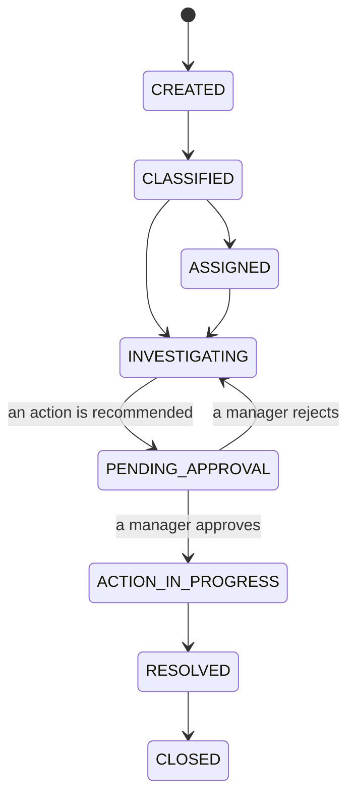
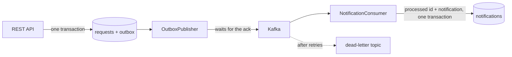

# OpsFlow AI — AI-assisted business operations and workflow platform

[](https://github.com/iamsrkg/opsflow-ai/actions/workflows/ci.yml)

> **OpsFlow AI** is an event-driven platform for business operations. It manages operational requests, enforces their workflow with a state machine, publishes every change reliably to Kafka, investigates each request using the system's own records and a searchable runbook library, and produces evidence-backed recommendations that only take effect once a manager approves them.

## Live demo

**With the real backend, in your browser:** [](https://codespaces.new/iamsrkg/opsflow-ai?quickstart=1)

One click starts the whole system (dashboard, Spring Boot backend, PostgreSQL with pgvector, Kafka and Redis) in your own GitHub account and opens the dashboard when it is ready. It is free, needs a GitHub login, and the first start takes a few minutes while the images build. Sign in with `manager` / `manager123`, `agent` / `agent123` or `viewer` / `viewer123`.

**On your machine:** `docker compose up --build`, then http://localhost:3000.

**Dashboard preview, no login:** https://iamsrkg.github.io/opsflow-ai/ shows the dashboard on its own with sample data. No backend is connected to that page, and a banner on it says so.

There is no permanently hosted copy of the backend; the Codespaces button and Docker Compose are the two ways to use the real thing.

**In one sentence:** OpsFlow AI is the system an operations team would use to handle customer problems, where every problem follows fixed steps, software suggests the fix, and a person approves it.

**In a little more detail.** A customer reports "I was charged but my order still says pending". Someone has to find out what happened and decide what to do, and the fix (replaying a payment, refunding, re-dispatching a parcel) is not something to get wrong. OpsFlow gives that work a shape:

1. The problem becomes a **request** with a status, and it can only move through allowed steps.
2. An **investigation** collects the facts and recommends an action. This is the "AI" in the name: it can read, and it can suggest, and nothing more.
3. A **manager approves or rejects** the action. Until then nothing happens.
4. Every step is **recorded**, and every change is **published as an event** that other systems can react to, without ever being lost or handled twice.

It is a backend project. The interesting parts are the guarantees behind those four lines: the workflow can't be bypassed, two people can't overwrite each other, an event survives Kafka being down, a redelivered event is handled once, and the AI step can't act on its own.

**Built with** Java 17 and Spring Boot 3.3, PostgreSQL with pgvector, Kafka, Redis, and a React dashboard. 42 tests run against the real services, and CI starts the whole stack and tests it end to end.

## Real-world use cases

OpsFlow is for any team that takes in problems, has to work out what happened, and must be careful about the fix. The workflow is the same in each industry; the category, the runbook and the usual fix change.

| Industry | The problem | OpsFlow classifies it as | Evidence it gathers | Recommended action | Who decides |
|---|---|---|---|---|---|
| **E-commerce and payments** | A customer is debited ₹500 but the order still shows `PENDING` | `PAYMENT`, high priority | The request, its audit trail, whether its events were delivered, and the *Payment Synchronization Troubleshooting Runbook* with its similarity score | `REPLAY_PAYMENT_EVENT` | A manager must approve |
| **Travel and fintech** | A flight booking fails at checkout with a timeout, but the wallet was debited | `BOOKING`, high priority | The same, with the *Booking Failure & Inventory Recovery Guide* | `RELEASE_INVENTORY_AND_REFUND` | A manager must approve |
| **Logistics and last-mile delivery** | A courier marks a parcel delivered; the recipient never received it | `DELIVERY`, medium priority | The same; if no runbook is close enough, the evidence says so and the confidence is lower | `OPEN_COURIER_INVESTIGATION` | A manager must approve |
| **SaaS and API support** | A partner integration gets `504 Gateway Timeout` | `TECHNICAL`, critical priority | The same, tied together by the correlation id on every response | `ESCALATE_TO_ON_CALL` | A manager must approve |
| **Anything else** | A request no rule recognises | `OTHER` | The same | `REQUEST_MORE_INFORMATION` | Nobody; it changes nothing |

A test pins this table to the code (`RuleBasedAIProviderTest`).

### One case, start to finish

"I was charged ₹500 but my order still says payment pending."

| Step | Who | What happens | Request status |
|---|---|---|---|
| 1 | Agent | Creates the request. The change and its event are saved in one transaction. | `CREATED` |
| 2 | System | Classifies it as a payment problem, high priority. | `CLASSIFIED` |
| 3 | Agent | Presses **Investigate**. | `INVESTIGATING` |
| 4 | System | Collects the evidence and matches the payment runbook. | `INVESTIGATING` |
| 5 | System | Recommends `REPLAY_PAYMENT_EVENT`. The policy says that action needs approval. | `PENDING_APPROVAL` |
| 6 | Agent | Tries to approve it and is refused with `403`. | `PENDING_APPROVAL` |
| 7 | Manager | Reads the evidence and approves. | `ACTION_IN_PROGRESS`, then `RESOLVED` |
| 8 | System | Every step is in the audit trail under one correlation id, and each change went to Kafka as an event. | `RESOLVED` |

One honest limit: approving an action records the decision and resolves the request. No payment, booking or courier system is connected, so nothing is replayed or refunded for real.

## Try it

Start it with the Codespaces button or Docker Compose (see **Live demo** above). Each demo account has a different role and is allowed different things, so try more than one.

Things worth trying once it is running:

1. Sign in as `agent`, create a request ("Customer charged but order still pending"), open it and press **Investigate with AI**. The request moves to `PENDING_APPROVAL` and the evidence lists what the backend actually found.
2. Still as `agent`, try to approve it. The API answers 403 and the dashboard tells you why.
3. Sign out, sign in as `manager`, approve it. The request is resolved, and the audit trail shows every step with its correlation id.
4. Watch the "Outbox backlog" card: each change wrote an event, Kafka acknowledged it, and a consumer handled it.

## What it does, and how

**Workflow.** A request can only move along the transitions in `WorkflowStateMachine`. Anything else is refused with `409`, whether it comes from the dashboard, the API or the AI step.



**Concurrent edits.** Requests carry a JPA `@Version`. A transition can include the `expectedVersion` the client last read; if someone else changed the request in the meantime the call gets `409` instead of overwriting their change.

**Events that are not lost.** A change and its event are written in one database transaction (the outbox table). `OutboxPublisher` sends pending rows to Kafka and marks a row as published only after the broker has acknowledged it. If Kafka is down the rows wait, in order, and nothing is reported as sent.

**Events that are not handled twice.** The publisher can deliver an event more than once, so every event carries an id. `NotificationConsumer` records each id it has handled, in the same transaction as the work, and skips a redelivery. A message that can't be processed is retried, then moved to `<topic>.DLT` so it can't block the partition.



**The AI step, kept on a lead.**
- It can only read through `AIToolRegistry` (the request, its audit trail, its events, the runbooks). It has no database access of its own and no way to write.
- The evidence shown to the manager is collected by the backend from its own data, so it is fact whichever provider is used.
- `ActionPolicy` holds the list of actions that exist and which of them need approval. A provider can suggest an action; it can't invent one, and it can't mark its own suggestion as safe.
- Two providers: `RuleBasedAIProvider` (keyword rules, the default, no network) and `OpenAiCompatibleProvider` (any chat-completions API, such as OpenAI or Ollama). If the model can't be reached or answers badly, the rules answer in its place.

**Runbook search.** Each runbook chunk gets a 256-dimension embedding. On PostgreSQL it is stored in a pgvector column and searched by cosine distance through an HNSW index; on the in-memory database the same vectors are compared in Java. The embedding is feature hashing, not a learned model: it matches shared words, not synonyms. `EmbeddingService` is the one class to replace to use a real embedding model.

**Rate limiting.** A fixed-window counter in Redis, incremented and expired in one Lua script, checked before authentication. Login has its own lower limit. If Redis is down, requests are let through.

**Security.** JWT login, five roles, a role check on every endpoint. Only a manager or admin can approve, and an account that registers itself is always a viewer.

**Tracing a request.** Every response carries an `X-Correlation-ID`. It is on each log line, in the audit trail and inside the published event.

## Tests

`mvn test` in `backend/` runs 42 tests:

| Test | What it proves |
|---|---|
| `KafkaFlowTest` | Against an in-process Kafka broker: a request change is published and consumed into one notification; the same event delivered twice is handled once; an unreadable message goes to the dead-letter topic and the consumer carries on |
| `OutboxPublisherTest` | Nothing is marked published without an acknowledgement; a failure keeps later events waiting; a broken payload doesn't block the rest |
| `PostgresAndRedisTest` | Against real PostgreSQL (pgvector) and Redis containers: Flyway builds the schema and Hibernate validates against it, search ranks through pgvector, the sixth login in a minute gets `429` |
| `RequestApiTest` | Through the real security filters: no token, wrong password, role checks, illegal transitions, the stale-edit conflict, the outbox row |
| `InvestigationFlowTest` | A request from creation to resolution over HTTP, including the agent being refused the approval |
| `OpenAiCompatibleProviderTest` | What is sent to the model, and that a failed call or an unreadable answer falls back to the rules |
| `EmbeddingServiceTest`, `RunbookSearchTest`, `RateLimitFilterTest`, `RuleBasedAIProviderTest`, `WorkflowStateMachineTest` | The pieces on their own |

The container tests skip themselves on a machine without Docker and run in CI.

CI also builds both Docker images, starts the whole stack with Compose and runs [`scripts/smoke.sh`](scripts/smoke.sh) against it from the outside: sign-in, a request through Kafka to a notification, pgvector search, the approval rules and the rate limit. It then stops Kafka, checks that a new request is still accepted and its event waits in the outbox, starts Kafka again and checks that the backlog drains.

## Run the pieces yourself

Backend alone, with nothing else running (in-memory database, Kafka and Redis switched off, events wait in the outbox):

```bash
cd backend
mvn spring-boot:run
```

Dashboard against it:

```bash
cd frontend
npm install
npm run dev        # http://localhost:3000, proxies /api to localhost:8080
```

Settings, all optional:

| Variable | Default | What it does |
|---|---|---|
| `SPRING_PROFILES_ACTIVE` | (none) | `prod` uses PostgreSQL, Flyway and pgvector |
| `KAFKA_ENABLED` | `false` | publish and consume events |
| `RATE_LIMIT_ENABLED` | `false` | rate limiting in Redis |
| `AI_PROVIDER` | `rules` | `openai` to call a model; then set `AI_BASE_URL`, `AI_API_KEY`, `AI_MODEL` |

`infrastructure/docker-compose.yml` starts only PostgreSQL, Kafka, Redis, Prometheus and Grafana, for running the backend from an IDE against real services.

## What it is not

- **Not a real embedding model.** Runbook search matches shared words. See "Runbook search" above.
- **One consumer.** Notifications are the only thing consuming the events so far.
- **No tracing system.** Correlation ids tie logs, audit entries and events together, but there are no spans or OpenTelemetry export.
- **The outbox publisher is single-instance.** Two copies of the application would both read the same pending rows. Running more than one needs row claiming (`SELECT … FOR UPDATE SKIP LOCKED`).
- **Approved actions are recorded, not executed.** Approving moves the request to resolved; there is no payment system behind `REPLAY_PAYMENT_EVENT`.
- **Demo accounts are seeded** with known passwords, and the JWT secret has a development default. Both must be changed for anything beyond a demo.

## Layout

```
backend/src/main/java/com/opsflow/
  identity/      login, JWT, users, roles
  request/       the request entity, service and API
  workflow/      the state machine
  outbox/        outbox table and publisher
  events/        event envelope, topics, processed-event table
  notification/  the Kafka consumer and what it writes
  ai/            tool registry, evidence, action policy, the two providers
  approval/      approval queue
  audit/         audit trail
  knowledge/     runbooks, embeddings, the two vector indexes
  ratelimit/     the Redis rate limiter and its filter
  analytics/     dashboard numbers
backend/src/main/resources/db/migration/   Flyway migrations
frontend/        React dashboard, Dockerfile, nginx config
docker-compose.yml   the whole stack
scripts/smoke.sh     end-to-end check of a running stack
docs/            architecture, decisions, failure scenarios, API
```

## Design notes

- [Architecture](docs/ARCHITECTURE.md): the modules, the tables that carry the design, and the path of one request
- [Decisions](docs/DECISIONS.md): why the outbox, why idempotent consumers, why the AI can only recommend, and what each choice costs
- [What happens when things fail](docs/FAILURE_SCENARIOS.md): each failure, what the system does, and the test that shows it
- [API](docs/API.md): endpoints, roles, status codes and the event format

## License

MIT. See [LICENSE](LICENSE).
