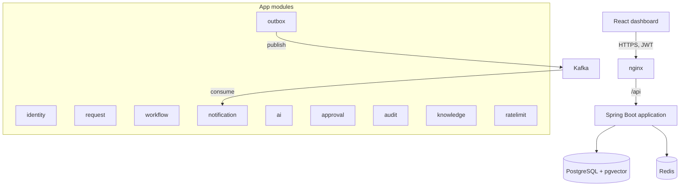
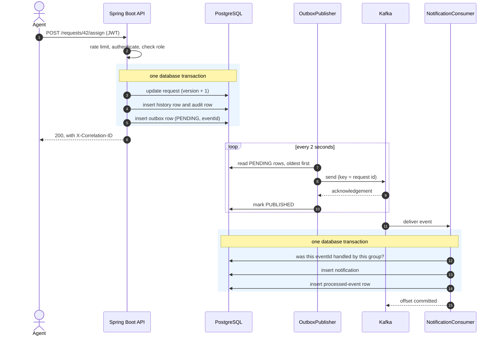
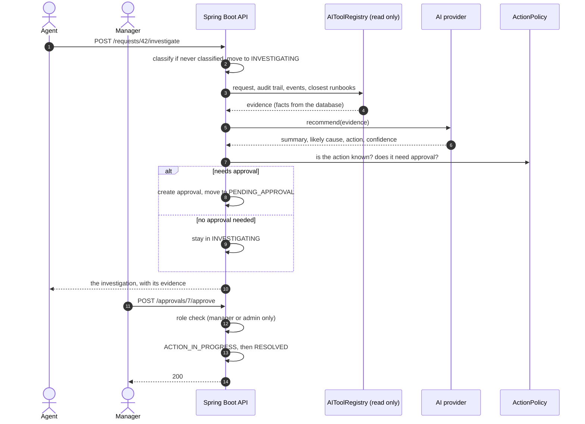

# Architecture

One Spring Boot application, split into packages by what they are responsible for, with PostgreSQL, Kafka and Redis around it and a React dashboard in front.

## The path of one request

1. **Rate limit.** `RateLimitFilter` counts the call in Redis before anything else happens. Over the limit, the answer is `429` and no password hash or query is spent on it.
2. **Authentication.** `JwtAuthenticationFilter` checks the token and loads the user's role. Each controller method states which roles may call it.
3. **The change.** `RequestService` loads the request, asks `WorkflowStateMachine` whether the transition is allowed, and saves it. In the same transaction it writes a history row, an audit row and an outbox row.
4. **Publishing.** `OutboxPublisher` runs every two seconds and keeps taking batches of 50 pending rows until the outbox is empty. It sends each row to Kafka, waits for the broker to acknowledge it, and writes the batch's new statuses together.
5. **Consuming.** `NotificationConsumer` reads the event. `NotificationService` checks whether this event id was already handled, writes the notification and the "handled" marker in one transaction.

Steps 1 to 3 happen while the caller waits. Steps 4 and 5 happen afterwards, so a slow or unavailable Kafka never slows down or fails the API call.

## The life of a request, in sequence

Creating and assigning a request, and what follows from it:

Investigating and approving:

## What happens at startup

1. **Flyway** runs any migration that hasn't run yet (PostgreSQL profile).
2. **Hibernate** validates every entity against the schema and stops the application if they disagree.
3. **`DataInitializer`** seeds the demo users, runbooks and sample requests if the tables are empty.
4. **`VectorStoreService`** gives every runbook chunk without an embedding one. Only after this does the application report ready, so `/actuator/health` is not UP while the index is still being built.
5. **Kafka**: if enabled, the topics and their dead-letter topics are created and the consumer starts; the outbox publisher begins polling.

## Modules

| Package | Responsibility |
|---|---|
| `identity` | Login, JWT creation and validation, users and roles |
| `request` | The request entity, its API, and the service that changes it |
| `workflow` | The table of allowed state transitions |
| `outbox` | The outbox table and the publisher |
| `events` | The event envelope, topic names, and the table of handled events |
| `notification` | The Kafka consumer and the notifications it writes |
| `ai` | Evidence collection, the tool registry, the action policy, and the two providers |
| `approval` | The queue of recommended actions waiting for a manager |
| `audit` | Who did what, with the correlation id |
| `knowledge` | Runbooks, embeddings, and the pgvector and in-memory indexes |
| `ratelimit` | The Redis counter and the filter that uses it |
| `analytics` | The numbers on the dashboard |

## Data

Flyway owns the PostgreSQL schema (`backend/src/main/resources/db/migration`). Hibernate is set to `validate`, so the application refuses to start if an entity and the schema disagree.

The tables that carry the design:

- `requests` has a `version` column for optimistic locking.
- `outbox_events` has a unique `event_id`, a `status` and an `attempts` counter.
- `processed_events` has a unique constraint on `(event_id, consumer_group)`. That constraint is what makes handling an event twice impossible, even if two consumers race.
- `knowledge_chunks` has an `embedding vector(256)` column (feature hashing) and an `embedding_model vector(384)` column (an embedding model), each with an HNSW index for cosine distance, and `embedding_model_name` to record which model made the vector.

## Two ways to run it

| | In-memory profile (default) | `prod` profile |
|---|---|---|
| Database | H2, tables created by Hibernate | PostgreSQL, schema from Flyway |
| Runbook search | vectors compared in Java | pgvector |
| Kafka | off unless `KAFKA_ENABLED=true`; events wait in the outbox | on in Docker Compose |
| Rate limiting | off unless `RATE_LIMIT_ENABLED=true` | on in Docker Compose |

The default profile exists so the backend starts with nothing else installed. The same code paths run in both; only the storage behind `VectorIndex` differs.
