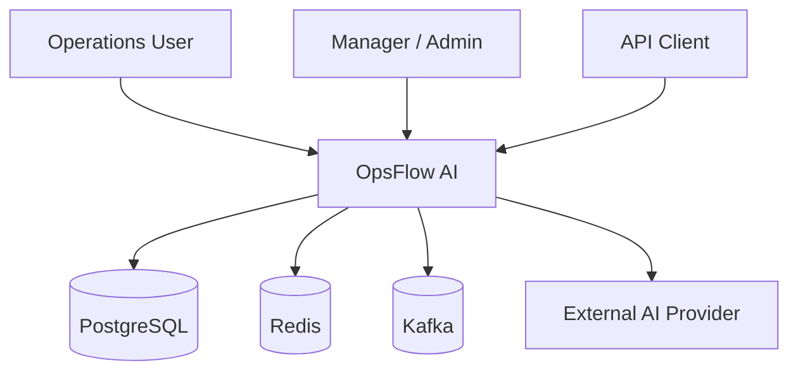
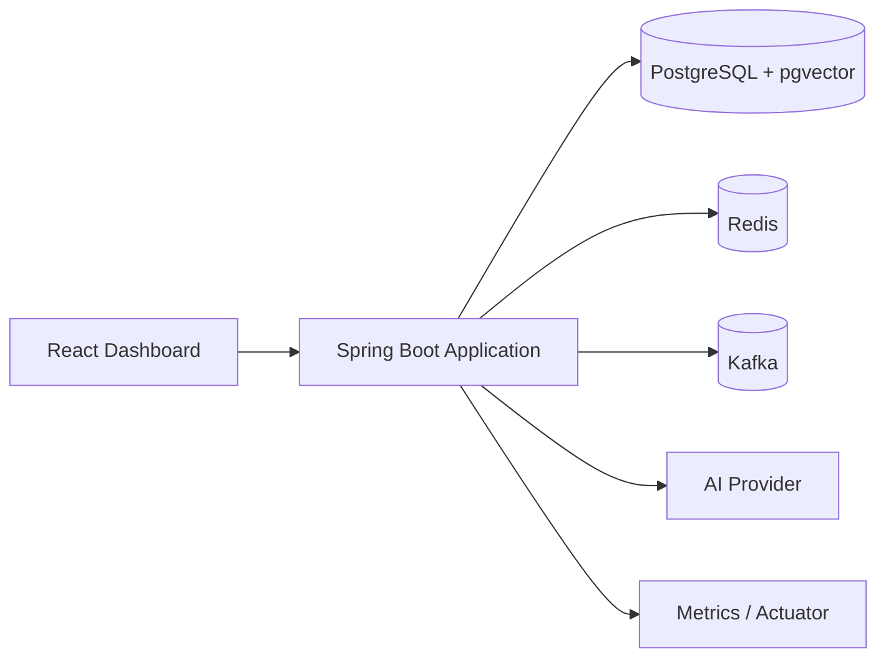
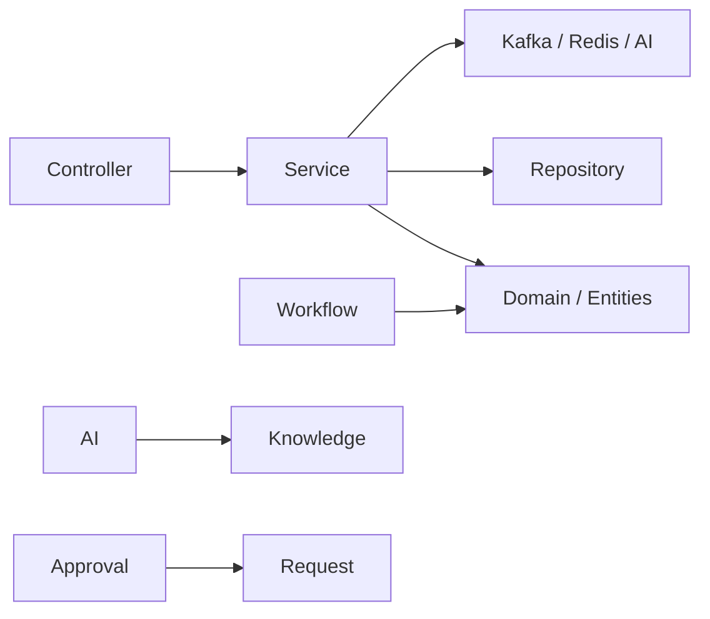

# Master Architecture

## Architectural style

**Modular monolith + event-driven integration + AI application layer + human-in-the-loop control.**

This is intentionally not “microservices everywhere”. The application starts as one deployable Spring Boot unit with explicit domain packages and uses Kafka where asynchronous decoupling provides real value.

## C4-style context



## Container view



## Internal modules

```text
com.opsflow
├── request       request aggregate, CRUD, workflow-facing operations
├── workflow      state machine and transition rules
├── audit         immutable-ish operational history
├── outbox        domain event envelope, outbox publisher, Kafka consumer
├── ops           correlation ID, Redis, rate limiting, metrics
├── security      users, authentication, JWT, roles and permissions
├── knowledge     documents, embeddings, vector retrieval
├── ai            provider abstraction, classification, investigation
├── approval      human approval and controlled action execution
└── common        cross-cutting API exception handling
```

## Dependency direction



The important principle is that business rules are not delegated to the UI or LLM.

## Why this architecture?

| Decision | Reason | Main trade-off |
|---|---|---|
| Modular monolith | Low operational complexity, clear boundaries | One deployment unit |
| PostgreSQL | ACID + relational model + mature indexing + pgvector | Vertical scaling eventually needs planning |
| Kafka | Async decoupling and event-driven integration | Operational complexity |
| Outbox | Avoid DB/event dual-write inconsistency | At-least-once publication |
| Redis | Low-latency cache/rate limiting | Extra infrastructure and invalidation complexity |
| JWT | Stateless API authentication | Revocation is harder |
| pgvector | Keep vector search beside operational data | Not always ideal at very large vector scale |
| AI provider abstraction | Vendor independence/testability | Extra abstraction |
| Human approval | Safety/control | More workflow latency |

## Trust boundaries

```text
UNTRUSTED INPUT
  -> HTTP validation
  -> authentication
  -> authorization
  -> business rules
  -> controlled data access
  -> AI reasoning
  -> backend validation again
  -> human approval where required
  -> deterministic action
```

The LLM is **not** the trust boundary.
