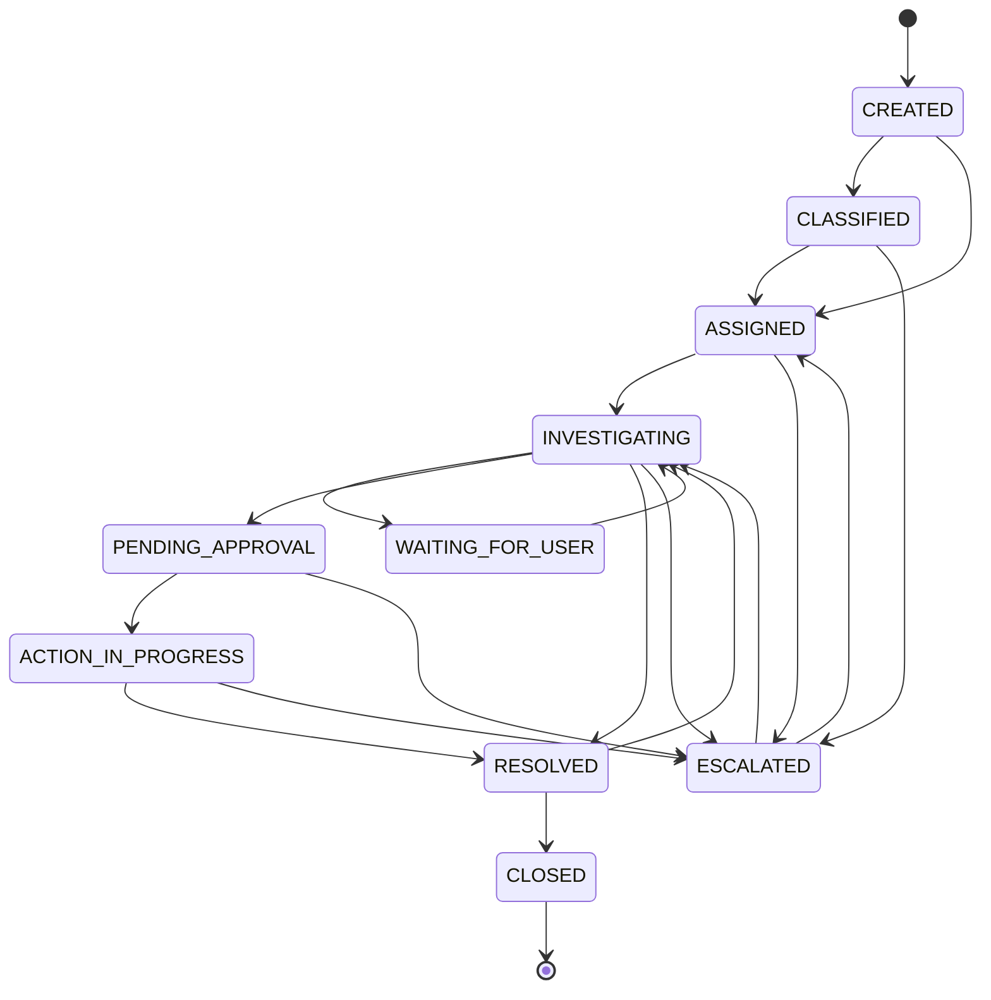

# Workflow State Machine

## State graph

The exact allowed transitions are defined in `WorkflowEngine` and must be treated as the source of truth for runtime behavior.

## Why a state machine?

Without a state machine, callers can accidentally perform invalid operations such as executing an action on a request that has not reached approval. A state machine centralizes legal transitions and makes the lifecycle testable.

## Interview explanation

> “I kept workflow transitions in the backend domain layer instead of allowing the UI or AI to set arbitrary status values. That gives me one authoritative transition policy. The entity also uses optimistic locking so concurrent updates cannot silently overwrite each other.”

## Concurrency scenario

Two operators read `INVESTIGATING`.

- Operator A transitions to `RESOLVED`.
- Operator B tries the same request based on the stale version.
- JPA detects the version mismatch.
- The second update fails instead of silently overwriting the first.
- The API should expose this as a conflict and the client should refresh.

## Approval boundary

When an approval is requested from an `INVESTIGATING` request, the service moves the request to `PENDING_APPROVAL` before creating the approval record in the same transaction. Approval then moves through `PENDING -> APPROVED/REJECTED -> EXECUTED`. The `EXECUTED` state prevents accidental repeated execution and the entity version protects concurrent approval decisions.
