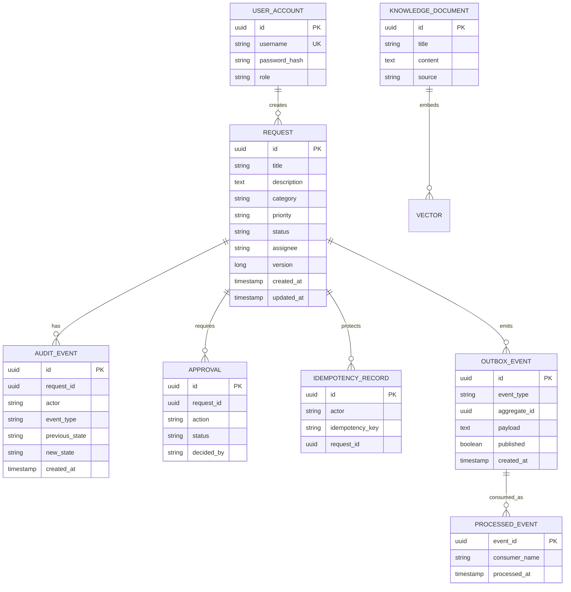

# Data Model

## Logical entities



## Source of truth

- Request state: PostgreSQL.
- Audit history: PostgreSQL.
- Outbox publication intent: PostgreSQL.
- Kafka: transport/event distribution, not authoritative request state.
- Redis: acceleration/short-lived coordination, not source of truth.
- pgvector: searchable knowledge representation, not authoritative business state.
- AI output: recommendation/analysis, not authoritative business state.

## Transaction boundary

For request creation:

```text
BEGIN
  request INSERT
  audit INSERT
  outbox INSERT
  idempotency INSERT (optional)
COMMIT
```

Kafka publication occurs after that transaction.

## Cache-aside behavior

Request reads first consult Redis. On a miss, PostgreSQL remains the source of truth; the response is then written to Redis with a short TTL. Mutations evict the request cache key after the database change. Redis failure is deliberately fail-open for this portfolio implementation so cache availability does not become a source-of-truth dependency.
