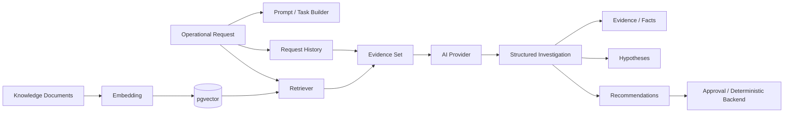

# AI + RAG Architecture

## Goal

Use AI where language reasoning helps, while keeping authorization, state transitions and sensitive actions deterministic.

## Pipeline

## Retrieval flow

1. Knowledge document is created.
2. Text is converted to a vector.
3. Vector is stored with the document.
4. Investigation query is embedded.
5. Similar vectors are retrieved.
6. Relevant text becomes bounded evidence.
7. AI receives the evidence plus task instructions.
8. Output is separated into facts, hypotheses and recommendations.

## Current embedding implementation

The repository uses a deterministic 64-dimensional local hashing embedding so the demo works without an API key. This is intentionally a **demo embedding**, not a claim of production semantic quality.

## Production evolution

Replace it with a high-quality embedding model and establish an evaluation set covering:

- retrieval relevance;
- recall@k / precision@k;
- unsupported claims;
- classification accuracy;
- structured-output validity;
- latency;
- cost.

## Prompt injection defense

Treat retrieved documents and user text as untrusted data. They are evidence, not instructions with authority.

The backend must never interpret model text as permission to bypass authorization.

## AI provider abstraction

`AiProvider` makes the application independent of one model vendor. This also allows deterministic testing without network access.

## Golden rule

> The model can suggest what should happen; only trusted backend code decides what is allowed to happen.
