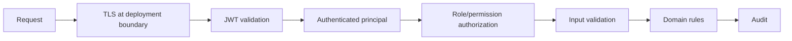

# Security Architecture

## Authentication

- Username/password registration/login.
- BCrypt password hashing.
- Signed JWT access tokens.
- Stateless Spring Security resource-server validation.

## Authorization

Roles currently include:

- ADMIN
- MANAGER
- AGENT
- OPERATOR
- VIEWER

JWTs also carry permission claims, providing a path toward finer-grained authorization.

## Request flow

## AI security

The model is treated as untrusted.

It does not:

- receive raw database credentials;
- execute arbitrary SQL;
- choose its own authorization scope;
- directly mutate protected records;
- directly perform refunds/deletions/permission changes.

## Threats to discuss

| Threat | Mitigation |
|---|---|
| Stolen JWT | short TTL + future refresh/revocation controls |
| Brute-force login | rate limiting + production lockout strategy |
| Prompt injection | bounded evidence + backend authorization |
| Data leakage | resource-level authorization + minimization |
| SQL injection | parameterized JPA/JDBC queries |
| Duplicate mutation | idempotency key |
| Replay/event duplication | processed-event tracking |
| Secrets in code | environment/secret manager in production |
| Dependency vulnerabilities | CI scanning |

## Production hardening

Use a secret manager, signing-key rotation, TLS everywhere, security headers, dependency/SAST/DAST scanning, least privilege, resource-level authorization and centralized audit retention.
