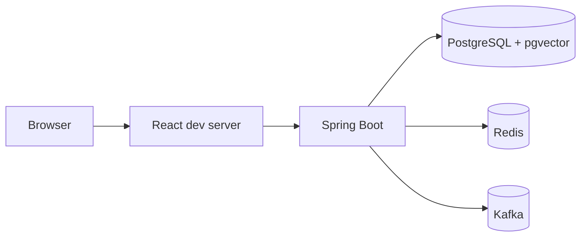
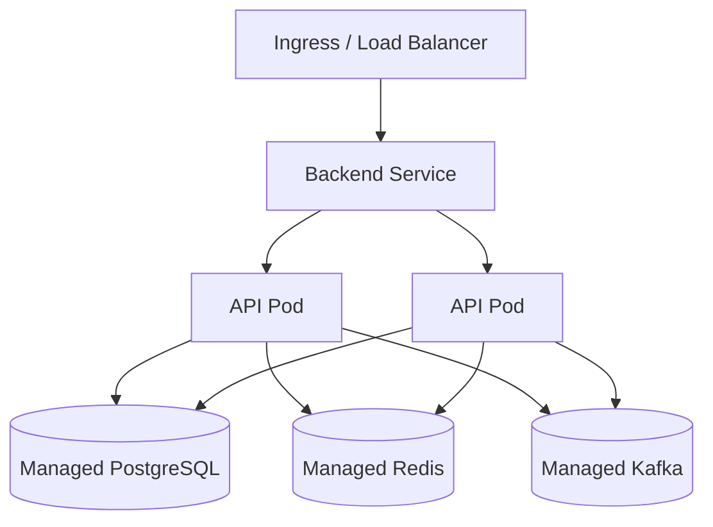

# Deployment Architecture

## Local



Docker Compose starts the supporting infrastructure.

## Kubernetes target



## Health checks

Use:

- liveness: process is alive;
- readiness: dependencies/initialization permit traffic;
- startup probe when initialization can be slow.

## CI/CD target

```text
Commit
 -> compile
 -> unit tests
 -> integration tests
 -> static/security scan
 -> build image
 -> image scan
 -> push registry
 -> deploy staging
 -> smoke test
 -> production approval
 -> rollout
```

## Production secrets

Never commit:

- JWT secret;
- AI API key;
- database password;
- cloud credentials.

Use a cloud secret manager/Kubernetes Secret mechanism backed by a proper secret store.
